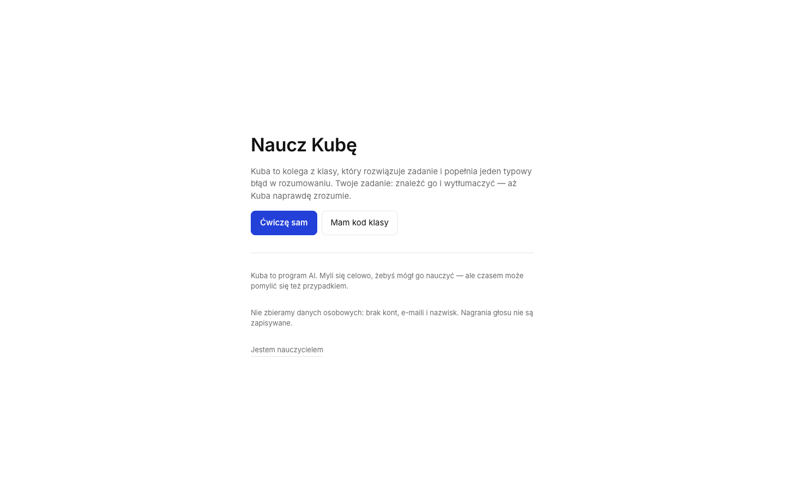
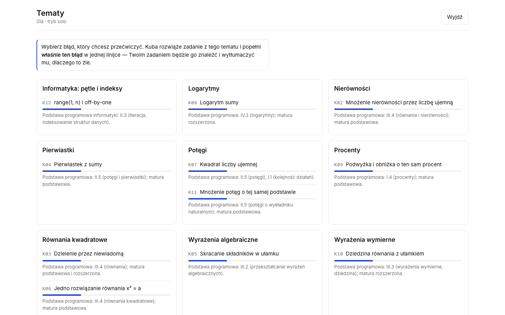
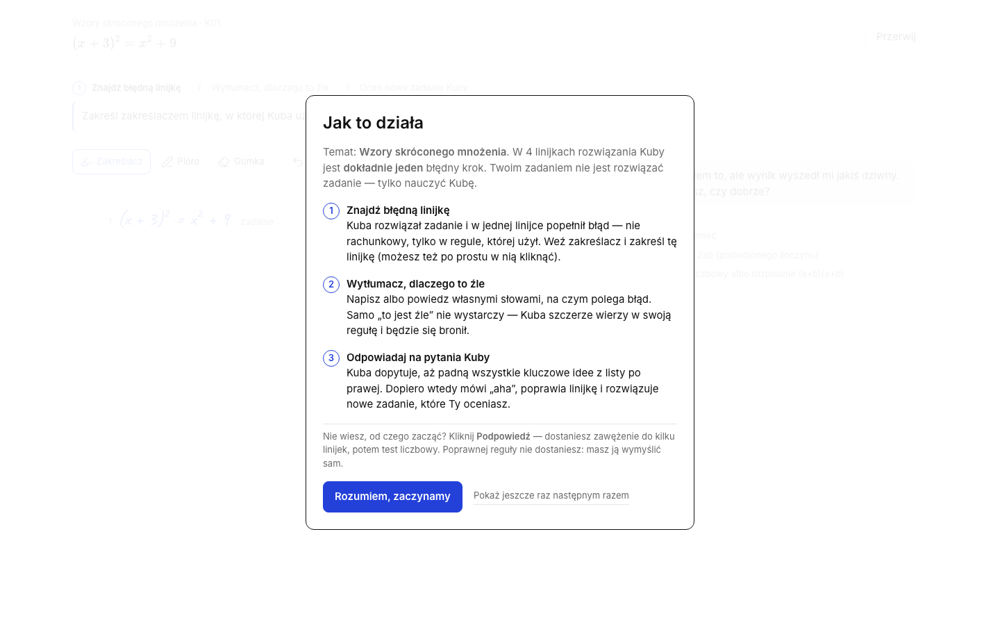
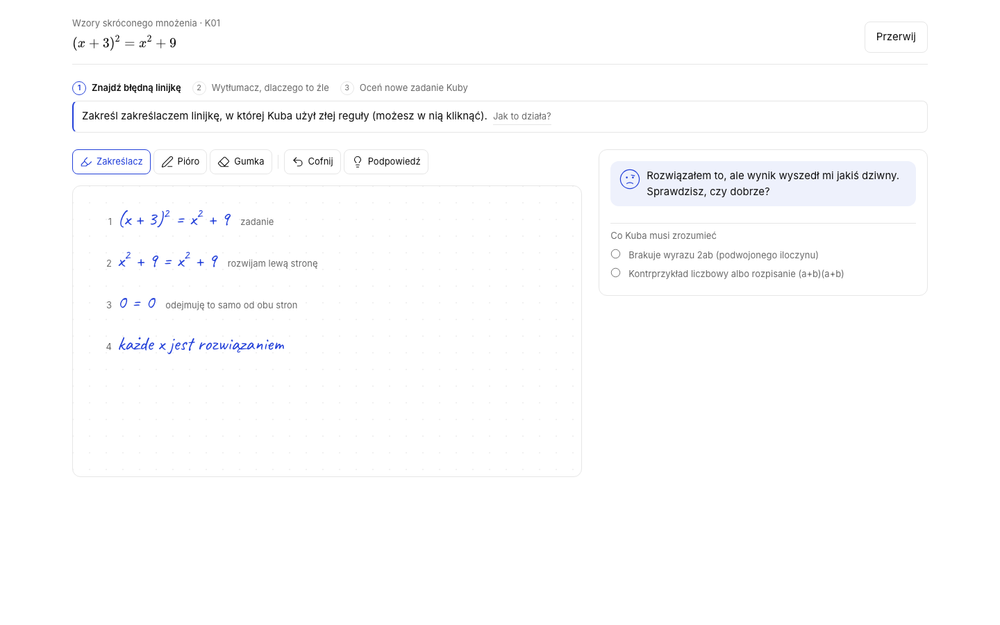
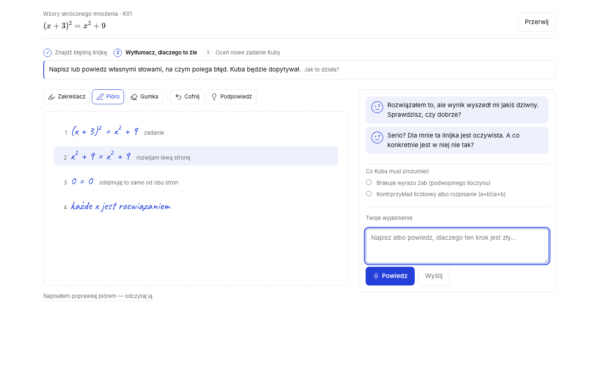
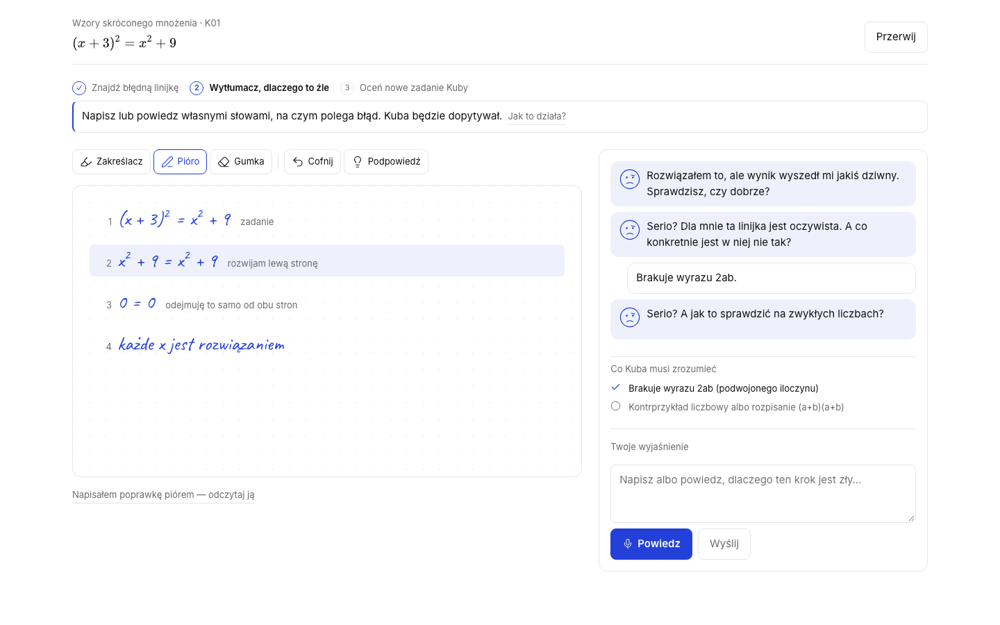
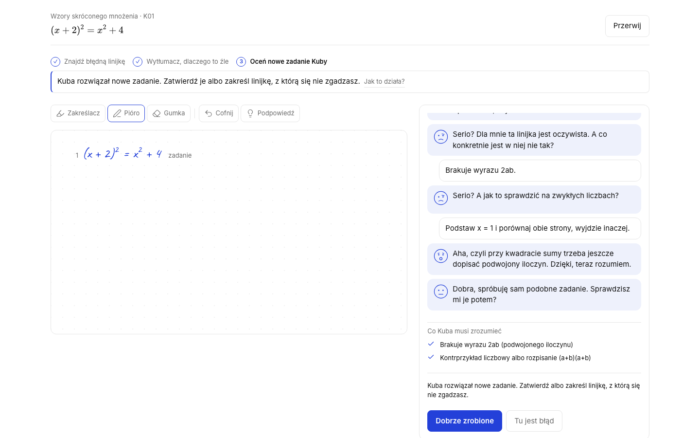
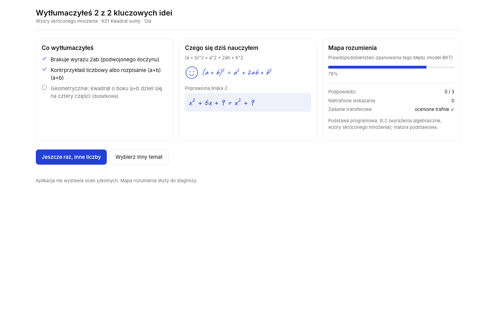
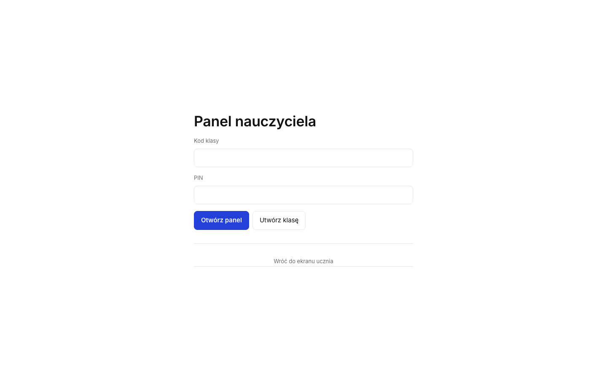

# Naucz Kubę — instrukcja użytkownika

Kuba to wirtualny kolega z klasy. Rozwiązuje zadanie z matematyki i **popełnia
jeden typowy błąd w rozumowaniu**. Twoim zadaniem nie jest rozwiązanie zadania —
tylko znalezienie błędu i wytłumaczenie Kubie, dlaczego to źle.

Dlaczego tak: najlepiej uczysz się wtedy, gdy uczysz kogoś innego (efekt protegowanego).

Wszystkie zrzuty poniżej pochodzą z działającej aplikacji.

---

## 1. Ekran startowy

Wybierz **„Ćwiczę sam"** albo wpisz 6-znakowy kod klasy od nauczyciela.
Potrzebny jest tylko pseudonim — bez konta, e-maila i nazwiska. Pole pseudonimu
celowo odrzuca adresy e-mail. Na dole znajdziesz informację, że Kuba jest programem AI.

---

## 2. Wybór tematu

Lista 12 typowych błędów pogrupowanych w tematy. Cienki pasek przy każdej pozycji
pokazuje Twoje opanowanie tego błędu (model BKT) — na początku jest niski.
Wybierz błąd, który chcesz przećwiczyć; Kuba popełni **właśnie ten** błąd
w jednej linijce.

---

## 3. Jak to działa

Przy pierwszym wejściu na tablicę pojawia się karta z trzema krokami:
znajdź → wytłumacz → odpowiadaj na pytania Kuby. Możesz ją wywołać ponownie
linkiem **„Jak to działa?"** nad tablicą.

---

## 4. Tablica — Kuba pisze rozwiązanie

Kuba pisze rozwiązanie linijka po linijce swoim pismem, z komentarzem przy każdym
kroku. Po prawej prosi o sprawdzenie. Nad tablicą widać pasek kroków
(**1 Znajdź → 2 Wytłumacz → 3 Oceń**) z jednym zdaniem instrukcji dopasowanym
do etapu — nigdy nie musisz zgadywać, co zrobić.

Narzędzia: **Zakreślacz** (wskaż błąd), **Pióro** (napisz poprawkę),
**Gumka**, **Cofnij**, **Podpowiedź**.

---

## 5. Zakreśl błędną linijkę

Zakreślaczem wskaż linijkę, w której Kuba użył złej reguły (możesz też w nią kliknąć).
Zakreślona linijka podświetla się na niebiesko.

Kuba **się broni** — uważa, że jego linijka jest oczywista, i pyta, co konkretnie
jest w niej nie tak. Po prawej pojawia się lista **„Co Kuba musi zrozumieć"**:
to kluczowe idee, które muszą paść w Twoim wyjaśnieniu.

Jeśli wskażesz złą linijkę, Kuba dopyta „a co tu jest nie tak?". Po dwóch próbach
włącza się drabinka podpowiedzi — trzy poziomy, które naprowadzają, ale **nigdy
nie podają poprawnej reguły wprost**.

---

## 6. Wytłumacz, na czym polega błąd

Wyjaśnij własnymi słowami — pisząc w polu **„Twoje wyjaśnienie"**, pisząc piórem
po tablicy albo mówiąc (przycisk **„Powiedz"**; nagranie jest zamieniane na tekst,
który możesz poprawić przed wysłaniem).

System sprawdza, czy wyjaśnienie zawiera **wszystkie kluczowe idee**, i dla każdej
wymaga **dosłownego cytatu** z Twojej wypowiedzi jako dowodu. Zaliczone idee
dostają ✓. Na zrzucie zaliczona jest jedna z dwóch — Kuba dopytuje o drugą
(„a jak to sprawdzić na zwykłych liczbach?").

Samo wskazanie błędu nie wystarczy. Wklejony skądś tekst też nie przejdzie,
bo Kuba dopytuje o to, co sam/sama napisałeś.

---

## 7. Zadanie transferowe

Gdy Kuba zrozumie, streszcza regułę własnymi słowami, poprawia linijkę
i **rozwiązuje nowe, podobne zadanie sam**. W około 30% przypadków znów się myli —
Twoim zadaniem jest to wyłapać. Zatwierdź rozwiązanie przyciskiem
**„Dobrze zrobione"** albo zakreśl linijkę, z którą się nie zgadzasz.

To sprawdza czujność, a nie zgadywanie: obie wersje zadania mają identyczną
liczbę linijek, więc po samej długości nie poznasz odpowiedzi.

---

## 8. Podsumowanie

Na koniec widzisz:

- **Co wytłumaczyłeś** — kluczowe idee z ✓,
- **Czego się dziś nauczyłem** — reguła zapisana przez Kubę i poprawiona linijka,
- **Mapa rozumienia** — prawdopodobieństwo opanowania tego błędu (model BKT),
  razem z liczbą podpowiedzi i nietrafionych wskazań.

Aplikacja **nie wystawia ocen szkolnych** — mapa rozumienia służy do diagnozy.

Możesz powtórzyć ten sam błąd na innych liczbach („Jeszcze raz, inne liczby")
albo wybrać inny temat.

---

## 9. Panel nauczyciela

Nauczyciel zakłada klasę i dostaje 6-znakowy kod dla uczniów oraz PIN do panelu.
W panelu widać:

- **mapę ciepła** uczniowie × błędy — od razu widać, których błędów klasa nie wyłapuje,
- sekcję **„Czego klasa nie wyłapuje"** z listą pozycji katalogu,
- filtr tematów i **eksport CSV**,
- przycisk **„Usuń klasę i wszystkie dane"**.

Nauczyciel widzi **mapę opanowania, a nie treść rozmów uczniów**. Panel wymaga PIN-u.

---

## 10. Dobre praktyki

- **Tłumacz własnymi słowami.** Ewaluator wymaga cytatów z Twojej wypowiedzi —
  skopiowana definicja z internetu nie przejdzie kolejnej rundy pytań.
- **Podawaj kontrprzykłady liczbowe.** „Sprawdź x = 1: wychodzi 16, a nie 10"
  to mocniejszy argument niż „bo tak jest we wzorze".
- **Nie spiesz się z podpowiedziami.** Każda użyta podpowiedź jest zapisywana
  w podsumowaniu; i tak nigdy nie zdradzi reguły wprost.
- **Czytaj zadanie transferowe uważnie** — co trzecie ma błąd.
